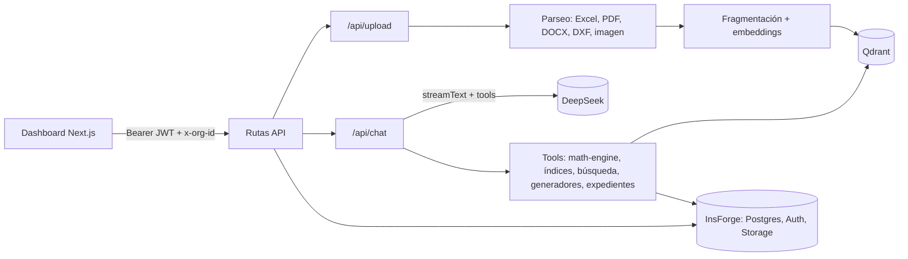

# EdificIA

Asistente de IA para empresas constructoras argentinas. Lee presupuestos,
planos y pliegos, los audita con cálculos determinísticos y deja el trabajo
ordenado por obra y por expediente. Es multi-tenant: cada empresa ve solo sus
datos.

## Problema

En una constructora la documentación de cada obra está repartida entre Excel,
PDF, Word y planos CAD. Revisar a mano que un presupuesto cierre, que no haya
ítems duplicados o mal calculados, que las cantidades coincidan con el plano o
que los precios estén en rango es lento y propenso a errores.

EdificIA ofrece un chat donde se suben esos archivos. Un modelo de lenguaje
interpreta el documento y decide qué verificar, pero **las cuentas las hacen
funciones TypeScript determinísticas** que el modelo invoca como herramientas.
Cada cifra de la respuesta sale de una de esas funciones.

## Cómo funciona



1. Al subir un archivo se extraen ítems, texto o geometría; se guarda en
   Storage, se buscan datos personales, se compara contra documentos previos de
   la obra y se indexa para búsqueda.
2. En el chat, el agente usa 16 herramientas: totales, cierre, reglas de
   consistencia, incidencia por rubro, comparación con índices de precio (CAC,
   INDEC o lista propia), cómputo contra plano DXF, búsqueda en documentos,
   cobertura documental de la obra, tablas y gráficas, generación de
   presupuesto `.xlsx`, memoria `.docx` e informe `.pdf`, y cierre de expediente.
3. Cada sesión dentro de una obra abre un expediente que registra los turnos del
   agente, los cambios de estado y un veredicto final.

La organización y el usuario se fijan del lado del servidor en cada
herramienta; el modelo no puede pedir datos de otra empresa.

Más detalle en [docs/arquitectura.md](docs/arquitectura.md) y
[docs/dominio.md](docs/dominio.md) (reglas de auditoría, índices, fases).

## Stack

| Capa | Tecnología |
|---|---|
| App | Next.js 16 (App Router), React 19, TypeScript estricto |
| UI | Tailwind CSS 4, Base UI, lucide-react, Recharts, Framer Motion |
| Datos en cliente | TanStack Query 5, Zod 3 |
| Agente | Vercel AI SDK 6 con `@ai-sdk/openai-compatible` sobre DeepSeek |
| Búsqueda | Qdrant + embeddings `baai/bge-m3` (NVIDIA NIM); full-text de Postgres como alternativa |
| Backend | InsForge (Postgres, Auth, Storage) |
| Documentos | xlsx, pdf-parse, mammoth, dxf-viewer, jsPDF, docx |
| Email | Resend |
| Logs | pino |
| Tests | `node:test` con un loader mínimo para TypeScript |

## Instalación

Requisitos: Node.js 22+, un proyecto de InsForge y una API key de DeepSeek.
Qdrant, NVIDIA NIM y Resend son opcionales.

```bash
git clone https://github.com/nachapoticon-dot/EdificiA-Core.git
cd EdificiA-Core
npm ci
cp .env.local.example .env.local   # completar variables
npm run dev                        # http://localhost:3000
```

**Base de datos.** En un proyecto InsForge vacío, ejecutar primero los scripts
de `db/base-schema/` en orden y después `npm run migrate` (aplica
`migrations/` con el CLI de InsForge). Crear además el bucket de Storage
`presupuestos`. Este camino desde cero no está probado de punta a punta.

**Primer usuario.** El registro requiere invitación. Con `SUPER_ADMIN_KEY`
definida, entrar a `/super-admin`, crear una invitación de fundador y
registrarse en `/register` con ese email: se crea la organización con rol
`admin`. Desde `/dashboard/admin` se invita al resto del equipo.

**Docker.** `cp .env.docker.example .env.docker && docker compose up --build`
levanta la app (build standalone) y un Qdrant local. Las variables
`NEXT_PUBLIC_*` se fijan en build.

### Scripts

| Comando | Descripción |
|---|---|
| `npm run dev` | Servidor de desarrollo |
| `npm run build` / `npm start` | Build de producción y arranque |
| `npm run type-check` | `tsc --noEmit` |
| `npm run lint` | ESLint |
| `npm test` | Tests unitarios (sin red ni base de datos) |
| `npm run migrate` / `npm run migrate:new` | Aplicar / crear migraciones |

## Variables de entorno

| Variable | Requerida | Uso |
|---|---|---|
| `NEXT_PUBLIC_INSFORGE_URL` | Sí | URL del proyecto InsForge |
| `INSFORGE_SERVICE_ROLE_KEY` | Sí | Clave de servicio, solo servidor |
| `DEEPSEEK_API_KEY` | Sí | Modelo del agente |
| `SUPER_ADMIN_KEY` | Sí | Protege `/super-admin` y `/api/super-admin/*` |
| `AI_MODEL`, `AI_MODEL_FAST`, `AI_MODEL_DEEP` | No | Modelos; por defecto `deepseek-v4-flash` |
| `NVIDIA_API_KEY` | No | Embeddings; sin ella la búsqueda es solo full-text |
| `QDRANT_URL`, `QDRANT_API_KEY` | No | Base vectorial |
| `RESEND_API_KEY`, `RESEND_FROM_EMAIL` | No | Emails de invitación y recuperación de contraseña |
| `PASSWORD_RESET_SECRET` | No | HMAC de los tokens de reset (por defecto, la service role key) |
| `AUTH_STRICT_MODE` | No | `true` por defecto en producción: si InsForge no responde, se rechaza el token |
| `NEXT_PUBLIC_APP_URL` | No | URL pública para links en emails |
| `ALLOWED_ORIGINS` | No | Orígenes CORS de `/api/*`, separados por coma |
| `LOG_LEVEL` | No | Nivel de pino |

## Estructura

```text
src/
  proxy.ts            middleware: sesión, CORS, request-id
  app/
    (auth)/           login, registro, recuperación de contraseña
    dashboard/        chat, obras, expedientes, documentos, admin
    super-admin/      alta de empresas
    api/              33 rutas
  components/         chat, tarjetas de resultados, sidebar, primitivas UI
  hooks/, contexts/   estado de sesión, obra activa y consultas
  lib/
    ai/               prompt, tools, router de modelo, contexto del turno
    math-engine/      cálculos y reglas de auditoría
    indices/          índices de precio y comparación
    file-processor/   parseo de archivos (excel/ para presupuestos)
    documents/        contraste con documentos previos de la obra
    rag/              fragmentación, indexación y búsqueda
    work-cases/       expedientes
    export/           generadores xlsx, docx y pdf
    auth/, api/       autenticación, rate limit, errores
db/base-schema/       esquema base (SQL histórico)
migrations/           migraciones de InsForge
docs/                 arquitectura y dominio
tests/                tests unitarios
```

## Estado actual

Proyecto personal en desarrollo, sin usuarios en producción. Compila, pasa
type-check y lint, y los tests unitarios pasan. Se corre en local contra un
proyecto InsForge real.

Funciona:

- Autenticación multi-tenant con roles, invitaciones, recuperación de
  contraseña, selector de organización y panel de super-admin.
- Ingesta de Excel, PDF, DOCX, DXF e imágenes; búsqueda híbrida
  (vectorial + full-text); detección de datos personales; contraste numérico
  contra documentos previos de la obra.
- Auditoría de presupuestos con el motor de cálculo y comparación con índices
  de precio cargados por la empresa.
- Generación de presupuesto, memoria descriptiva e informe de auditoría.
- Obras con cobertura documental por fase, y expedientes con historial y cierre.

Limitaciones conocidas:

- Los tests cubren lógica pura (cálculos, parser de Excel, router de modelo,
  auth). No hay tests de integración de las rutas API ni de la UI.
- La base de datos desde cero (esquema base + migraciones) no se probó en
  limpio. Hay tablas en la base que el código actual no usa.
- El caché de ítems de Excel y el rate limiting son en memoria, por instancia.
- Las imágenes no pasan por OCR; los PDF escaneados no se leen.
- DWG no se procesa (solo DXF).
- Un único proveedor de modelo (DeepSeek), sin fallback.
- No hay un despliegue público.

## Licencia

Copyright (c) 2026 EdificIA. Todos los derechos reservados. El repositorio es
público solo como portafolio; no se otorga licencia de uso. Ver
[LICENSE](LICENSE).
