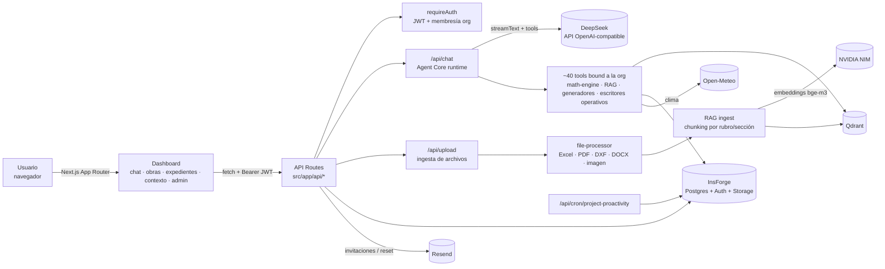

# EdificIA

> Un "Project Manager Digital" para constructoras: un agente de IA que lee la documentación de las obras (presupuestos, planos, pliegos, cronogramas), audita números, detecta riesgos y deja todo ordenado por obra y por expediente.

---

## ¿Qué problema intenta resolver?

En una constructora la información de cada obra está desparramada: presupuestos en Excel, planos DXF, pliegos y contratos en PDF/Word, cronogramas en planillas, seguros de subcontratistas, remitos de acopio, partes diarios. Controlar todo eso a mano es lento y los errores son caros: un presupuesto que no cierra, un ítem que falta contra el plano, una ART vencida, una lluvia que frena el hormigonado.

La idea de EdificIA es que el equipo (ingeniería, arquitectura, administración) le hable en castellano a un agente que:

1. **Lee y entiende los documentos** que se suben (o, a futuro, que se conectan desde Drive/SharePoint/ERP).
2. **Audita con matemática determinística**, no "a ojo" del LLM: totales, cierres, incidencias por rubro, exclusiones lógicas, comparación contra índices de precios (CAC/INDEC/propios).
3. **Contrasta documentos entre sí** (plano vs. cómputo, versión nueva vs. vieja, presupuesto A vs. B) y guarda esas relaciones.
4. **Es proactivo**: revisa cronograma, HSE, acopios, curva de inversión, clima y documentación vencida, y levanta hallazgos sin que nadie pregunte.
5. **Genera los entregables**: presupuestos .xlsx, memorias descriptivas .docx, informes PDF, órdenes de compra, actas de obra, emails a stakeholders.
6. **Deja trazabilidad**: cada trabajo vive en un *expediente operativo* con eventos, evidencias, corridas del agente y un veredicto de cierre; todo queda en un audit log inmutable.

El modelo mental que el código persigue es:

```text
Empresa → Obra → Expediente Operativo → Eventos / Evidencias / Acciones / Artefactos
```

Es un producto **multi-tenant**: cada constructora (organización) ve solo sus datos, y un mismo usuario (p. ej. un consultor) puede pertenecer a varias.

---

## Cómo funciona

### Vista general



### Componentes principales

| Componente | Dónde | Qué hace |
|---|---|---|
| **Proxy (middleware)** | `src/proxy.ts` | Protege `/dashboard/*` leyendo la cookie `edificia_session`, agrega `x-request-id` y maneja CORS de `/api/*` según `ALLOWED_ORIGINS`. |
| **Auth** | `src/lib/auth/` | `requireAuth()` valida el Bearer token contra InsForge (con caché de 60 s), resuelve la organización activa (header `x-org-id`) y el rol (`admin` / `engineer` / `viewer`). Las rutas `/api/super-admin/*` usan `SUPER_ADMIN_KEY`. |
| **Agent Core** | `src/lib/agent-core/` | Arma el *scope* de cada turno (org → obra → expediente), decide qué capacidades habilitar, compone el system prompt por módulos y registra cada corrida en `agent_runs`. |
| **Agente / LLM** | `src/app/api/chat/route.ts`, `src/lib/ai/` | Streaming con Vercel AI SDK v6 sobre DeepSeek. `model-router.ts` elige modelo "fast" o "deep" según la complejidad del pedido. `agent-tools-bound.ts` inyecta `organization_id` y obra del lado del servidor en cada tool, así el modelo nunca puede cruzar datos entre empresas. |
| **Motor matemático** | `src/lib/math-engine/` | Cálculos determinísticos de presupuestos (totales, cierre, incidencias, exclusiones). El LLM los invoca como tools en lugar de hacer cuentas. |
| **Procesamiento de archivos** | `src/lib/file-processor/`, `src/lib/excel/` | Extrae texto, tablas, ítems de presupuesto y geometría de DXF. DWG no está soportado (se informa al usuario). |
| **RAG** | `src/lib/rag/`, `src/lib/qdrant/`, `src/lib/embeddings/` | Chunking jerárquico por rubro/sección, embeddings `baai/bge-m3` (1024 dims) vía NVIDIA NIM y búsqueda en Qdrant filtrada por organización y obra. Si falta Qdrant o la clave de embeddings, cae a búsqueda full-text de PostgreSQL. |
| **Inteligencia documental y grafo** | `src/lib/document-intelligence/`, `src/lib/knowledge-graph/` | Al subir un archivo se escanea contra el contexto existente, se generan reportes documentales y relaciones (`contradicts`, `supersedes`, `derives_from`…) en `obra_relations`. |
| **Contexto empresarial** | `src/lib/enterprise-context/` | Construye un "perfil vivo" de la empresa (proveedores, monedas, obras en riesgo, patrones) que se inyecta en el prompt y se consulta con la tool `consultar_perfil_empresa`. |
| **Operaciones de obra** | `src/lib/project-operations/`, `src/lib/proactivity/` | Cronograma (incluye importación CSV), curva financiera, subcontratos, HSE, acopios, brief diario y el scan proactivo que persiste hallazgos en `operational_findings`. |
| **Exportación** | `src/lib/export/` | Generadores de PDF (jsPDF), DOCX (docx) y XLSX (xlsx). |
| **Observabilidad** | `src/lib/logger.ts`, `src/lib/observability/`, `src/lib/audit/` | Logs estructurados con pino, captura de errores en `app_error_events` (panel `/dashboard/admin/errors`) y audit log append-only. |

### Flujo de un mensaje de chat

1. El usuario escribe en `/dashboard/chat` (opcionalmente con una obra activa y archivos adjuntos).
2. Los archivos van primero a `/api/upload`: se validan extensión/MIME, se procesan, se buscan datos personales (PII), se guardan en el bucket de storage `presupuestos`, se indexan en el RAG y se generan reportes y relaciones documentales.
3. El mensaje va a `/api/chat` con headers `x-project-id` / `x-chat-session-id`. Se autentica, se aplica rate limit, se resuelve el scope del Agent Core y se elige el modelo.
4. DeepSeek razona y llama tools (hasta 20 pasos, 35 en modo "deep"). Las tools leen/escriben en InsForge y Qdrant siempre filtradas por organización.
5. La respuesta vuelve en streaming. Además de texto, el agente puede "proyectar" bloques de UI generativa (métricas, comparativas, cronogramas tipo Gantt, legajo gráfico) que el frontend renderiza como componentes.
6. Al terminar se registran `agent_runs`, eventos del expediente, audit log y patrones aprendidos de la sesión. El historial se guarda en `localStorage` y se sincroniza con la base para acceso desde otros dispositivos.

### Pantallas

| Ruta | Contenido |
|---|---|
| `/login`, `/register`, `/forgot-password`, `/reset-password` | Autenticación. El registro **solo funciona con invitación** (de fundador o de miembro). |
| `/dashboard/chat` | Chat principal con el agente. |
| `/dashboard/obras`, `/dashboard/obras/[id]`, `.../today` | Listado y detalle de obra: cobertura documental, expedientes, cronograma, brief diario. |
| `/dashboard/expedientes`, `/dashboard/obras/[id]/expedientes/[workCaseId]` | Mesa global de expedientes y detalle con replay de auditoría y cierre con veredicto. |
| `/dashboard/contexto` (+ `/fuentes`, `/perfil`) | Inteligencia Empresarial: Radar de evidencia, carga de fuentes y perfil empresarial. |
| `/dashboard/admin/*` | Miembros, alertas de error, patrones aprendidos, índices de precios, configuración de la org. |
| `/super-admin` | Panel global (protegido con `SUPER_ADMIN_KEY`): empresas, invitaciones de fundadores, reset de datos. |
| `/dashboard/blocks-demo` | Demo scripteada de los bloques de UI generativa. |

---

## Stack

| Capa | Tecnología |
|---|---|
| Framework | Next.js 16 (App Router, Turbopack) · React 19 · TypeScript strict |
| UI | Tailwind CSS v4 · componentes estilo shadcn (Base UI) · Framer Motion · Recharts · lucide-react |
| Estado / datos en cliente | TanStack Query v5 |
| Validación | Zod v3 (schemas compartidos cliente/servidor en `src/lib/validators/`) |
| Agente | Vercel AI SDK v6 + `@ai-sdk/openai-compatible` contra DeepSeek |
| Embeddings | NVIDIA NIM (`baai/bge-m3`) |
| Vector DB | Qdrant |
| Backend (BaaS) | [InsForge](https://insforge.dev): PostgreSQL, Auth y Storage |
| Email | Resend |
| Documentos | xlsx · pdf-parse · mammoth · dxf-viewer (lectura) · jsPDF · docx (generación) |
| Logs | pino |
| Tests | `node:test` nativo con un loader mínimo para TypeScript |

---

## Instalación y ejecución local

### Requisitos

- **Node.js 22 o superior** (el Dockerfile usa `node:22-alpine`) y npm 10+.
- Un proyecto de **InsForge** con su URL y service role key. Es la única dependencia externa imprescindible: auth, base de datos y storage viven ahí.
- Una **API key de DeepSeek** para que el chat responda.
- Opcionales: Qdrant (local o Cloud), API key de NVIDIA NIM (embeddings), cuenta de Resend (emails).

### Paso a paso

```bash
# 1. Clonar e instalar
git clone https://github.com/nachapoticon-dot/EdificiA-Core.git
cd EdificiA-Core
npm install          # el script "prepare" configura los git hooks de .githooks/

# 2. Variables de entorno
cp .env.local.example .env.local
# completar al menos NEXT_PUBLIC_INSFORGE_URL, INSFORGE_SERVICE_ROLE_KEY,
# DEEPSEEK_API_KEY y SUPER_ADMIN_KEY

# 3. Base de datos (InsForge CLI)
npx @insforge/cli login          # y vincular el proyecto según la doc de InsForge
npm run migrate                  # aplica migrations/ en orden

# 4. Levantar
npm run dev                      # http://localhost:3000
```

**Base de datos desde cero.** La carpeta `migrations/` arranca el 2026-05-07 con un "catch-up" que asume que el esquema base ya existe. Ese esquema base está en `docs/archive/db-migrations-legacy/001…016_*.sql` (histórico en SQL crudo). En un proyecto InsForge vacío hay que ejecutar primero esos scripts y después `npm run migrate`. Este camino no fue probado en limpio. También hay que crear en InsForge Storage el bucket **`presupuestos`**, que ninguna migración crea.

**Primer usuario.** El registro está cerrado por invitación. Para arrancar:

1. Definí `SUPER_ADMIN_KEY` en `.env.local`.
2. Entrá a `/super-admin`, ingresá la clave y creá una invitación de fundador con tu email y el nombre de la empresa.
3. Registrate en `/register` con ese email: se crea la organización y quedás como `admin`.
4. Desde `/dashboard/admin` podés invitar al resto del equipo (necesita Resend para mandar el mail).

En desarrollo también existe `POST /api/seed-demo` (`{ "email", "password" }`), que agrega un usuario ya existente como admin de una organización "EdificIA Demo".

### Con Docker

```bash
cp .env.docker.example .env.docker   # completar valores
docker compose up --build
```

`docker-compose.yml` levanta la app (build standalone), un **Qdrant** local y un **PostgreSQL 16** con WAL configurado. Ojo: la app no se conecta a ese Postgres (usa InsForge). El contenedor sirve para el flujo self-hosted y para `scripts/verify-wal.sh`. Las variables `NEXT_PUBLIC_*` se inlinean en build: pasalas con `--build-arg` si construís la imagen a mano.

### Scripts

| Comando | Qué hace |
|---|---|
| `npm run dev` | Servidor de desarrollo (Turbopack). |
| `npm run build` / `npm start` | Build de producción (`output: standalone`) y arranque. |
| `npm run type-check` | `tsc --noEmit`. |
| `npm run lint` | ESLint (config flat de Next). |
| `npm test` | Tests unitarios con `node:test` (`tests/**/*.test.mjs`). No necesitan red ni base. |
| `npm run smoke:chat` | Smoke E2E: 3 turnos reales contra DeepSeek (requiere `DEEPSEEK_API_KEY` en `.env.local`). El hook `pre-push` lo corre si cambiaste el runtime del agente. Se saltea con `SKIP_CHAT_SMOKE=1`. |
| `npm run migrate` / `npm run migrate:new` | Aplica / crea migraciones con el CLI de InsForge. |

---

## Configuración

Todas las variables están documentadas en [`.env.local.example`](./.env.local.example). Resumen:

| Variable | Obligatoria | Uso |
|---|---|---|
| `NEXT_PUBLIC_INSFORGE_URL` | Sí | URL del backend InsForge. |
| `INSFORGE_SERVICE_ROLE_KEY` | Sí | Clave admin de InsForge, solo del lado del servidor. |
| `DEEPSEEK_API_KEY` | Sí (chat) | LLM del agente. |
| `AI_MODEL`, `AI_MODEL_FAST`, `AI_MODEL_DEEP` | No | Modelos. Default `deepseek-v4-flash`. El router usa FAST o DEEP según la complejidad. |
| `SUPER_ADMIN_KEY` | Sí (para crear la primera empresa) | Protege `/super-admin` y `/api/super-admin/*`. |
| `CRON_SECRET` | En prod | Bearer de `/api/cron/project-proactivity`. Si falta, usa `SUPER_ADMIN_KEY`; en desarrollo sin secreto queda abierto. |
| `NVIDIA_API_KEY` | No | Embeddings. Sin ella el RAG usa búsqueda de texto de Postgres. |
| `QDRANT_URL`, `QDRANT_API_KEY` | No | Vector DB. Sin URL no se indexan vectores. |
| `RESEND_API_KEY`, `RESEND_FROM_EMAIL` | No | Emails de invitación, reset de contraseña y comunicaciones a stakeholders (sin clave, estas últimas quedan como *dry-run* en el audit log). |
| `PASSWORD_RESET_SECRET` | No | HMAC de los tokens de reset. Si falta, usa la service role key. |
| `AUTH_STRICT_MODE` | No | `true` por defecto en producción: si InsForge no responde, el token se rechaza. En desarrollo puede validarse solo decodificando el JWT. |
| `NEXT_PUBLIC_APP_URL` | No | URL pública, usada en links de emails. |
| `ALLOWED_ORIGINS` | No | Orígenes CORS para `/api/*`, separados por coma (default `http://localhost:3000`). |
| `LOG_LEVEL` | No | Nivel de pino (`debug` en dev, `info` en prod por defecto). |

Ejemplo mínimo de `.env.local` (valores ficticios):

```dotenv
NEXT_PUBLIC_INSFORGE_URL=https://miapp.us-east.insforge.app
INSFORGE_SERVICE_ROLE_KEY=<service-role-key>
DEEPSEEK_API_KEY=<deepseek-key>
SUPER_ADMIN_KEY=<una-cadena-larga-y-aleatoria>
NEXT_PUBLIC_APP_URL=http://localhost:3000
```

---

## Estructura del proyecto

```text
.
├── src/
│   ├── proxy.ts                 # Middleware: protección de /dashboard, CORS, request-id
│   ├── app/
│   │   ├── (auth)/              # login, register, forgot/reset password
│   │   ├── dashboard/           # chat, obras, expedientes, contexto, admin, blocks-demo
│   │   ├── super-admin/         # panel global
│   │   └── api/                 # 47 route handlers (chat, upload, projects, work-cases,
│   │                            #   documents, enterprise-context, generate/*, indices,
│   │                            #   proactivity, cron, sessions, admin, super-admin, auth…)
│   ├── components/
│   │   ├── chat/                # input, mensajes, cards, sidebar, bloques de UI generativa
│   │   ├── enterprise-context/  # panel de fuentes empresariales
│   │   └── ui/                  # primitivas (button, scroll-area, error-boundary)
│   ├── contexts/ · hooks/       # estado de sesión/obra y hooks de datos (TanStack Query)
│   ├── lib/                     # toda la lógica de negocio (ver tabla de componentes)
│   └── types/
├── migrations/                  # migraciones SQL activas (InsForge CLI)
├── db/seeds/                    # seed SQL inicial
├── docs/                        # visión, dominio, arquitectura, roadmap del agente
│   └── archive/db-migrations-legacy/  # esquema base histórico (001–016)
├── tests/                       # tests node:test + loader TS
├── scripts/                     # smoke-chat, verify-wal, instalación de git hooks
├── .githooks/pre-push           # corre smoke:chat si cambió el runtime del agente
├── Dockerfile · docker-compose.yml
├── ROADMAP.md                   # pendientes y prioridades
├── CLAUDE.md · AGENTS.md        # reglas para agentes de IA que trabajan en el repo
└── .env.local.example · .env.docker.example
```

Documentación más profunda en [`docs/`](./docs): visión (`01`), dominio de auditoría de presupuestos (`03`), mapa de arquitectura (`04`), capa de contexto empresarial (`06`), lectura agéntica de documentos (`07`) y rediseño Agent Core (`08`).

---

## Estado actual

El proyecto se desarrolló en sprints cortos, en buena parte con asistentes de IA. Hoy **compila, pasa lint y type-check, y sus 82 tests unitarios pasan**. El autor lo corre en local contra un proyecto InsForge real.

**Implementado (en código):**

- Auth multi-tenant con roles, invitaciones, reset de contraseña, selector de organización y panel super-admin.
- Chat con agente, router de modelos, ~40 tools, UI generativa y persistencia de sesiones (localStorage + DB).
- Ingesta de Excel, PDF, DXF, DOCX e imágenes; RAG híbrido (vectorial + full-text); detección de PII.
- Motor matemático de auditoría de presupuestos y comparación contra índices de precio (carga de índices append-only).
- Generación de presupuestos XLSX, memorias DOCX, informes PDF, órdenes de compra y actas.
- Datos operativos de obra (cronograma con importación CSV, curva financiera, subcontratos, HSE, acopios), brief diario y clima vía Open-Meteo.
- Expedientes operativos con eventos, evidencias, reportes documentales, `agent_runs` y cierre con veredicto (incluido el cierre propuesto por el agente).
- Perfil empresarial vivo integrado al prompt, grafo de relaciones documentales, memoria activa con confirmación explícita.
- Audit log inmutable y panel de errores operativos.

**Incompleto o pendiente:**

- **Deploy público pausado.** No hay URL estable: el último intento con InsForge Deployments falló del lado de la plataforma (ver `docs/AI_WORKLOG.md`).
- **Proactividad sin agenda.** El endpoint `/api/cron/project-proactivity` y el read model funcionan, pero nadie lo dispara todavía: falta registrar un schedule diario, y para eso hace falta la URL pública.
- **Conectores externos** (Google Drive, SharePoint, OneDrive, SQL, ERPs): están diseñados en `docs/06`, no implementados. Hoy las fuentes se cargan a mano.
- **No hay tests de integración ni E2E de UI.** Los tests cubren lógica pura; las rutas API y la UI se verifican a mano. Falta QA visual autenticado de las últimas pantallas.
- **No se probó levantar una base desde cero** (ver la nota de migraciones más arriba).

**Limitaciones conocidas:**

- El rate limiting es en memoria (por instancia), no distribuido.
- DWG no se procesa (solo DXF). Las imágenes se aceptan, pero sin OCR.
- La validación de JWT depende de que InsForge responda. En producción estricta, si InsForge cae, se rechazan los tokens.
- El agente depende de un único proveedor LLM (DeepSeek) sin fallback.

---

## Licencia

Copyright (c) 2026 EdificIA. Todos los derechos reservados.

El repositorio es público solo con fines de portafolio y evaluación. No se otorga licencia de uso, copia ni obras derivadas. Ver [LICENSE](./LICENSE).
